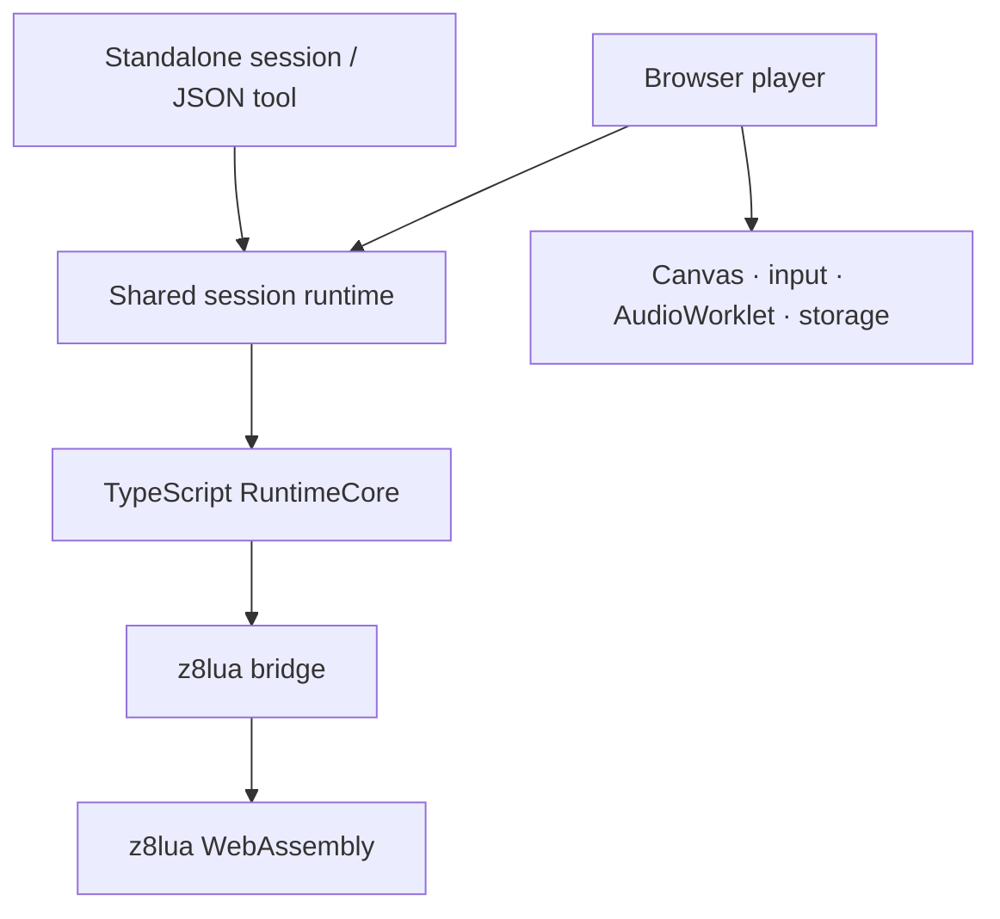

# PICO-8 Player

**Play cartridges in the browser. Run the same game one frame at a time in code.**

An embeddable PICO-8-compatible player and headless session API, built with TypeScript and z8lua WebAssembly. It powers [PICO-8 Maker](https://github.com/boxuechen/pico8-maker), and can also be used independently in browser applications, Node.js tests, and agent tool loops.

[](https://github.com/boxuechen/pico8-player/actions/workflows/verify.yml)
[](LICENSE)

[**Browser demo & static build**](https://boxuechen.github.io/pico8-player/) · [Quick start](#quick-start) · [Documentation](docs/README.md) · [简体中文](README.zh-CN.md)

> **Alpha software.** The target is the PICO-8 v0.2.7 cartridge runtime. Chrome/Chromium is the tested browser target; Node.js supports sessions without device output. This is an independent implementation, not an official Lexaloffle product. See [compatibility](docs/compatibility.md) for known differences.

## One runtime, two ways to use it

| | Browser player | Standalone session |
| --- | --- | --- |
| Entry point | `createPico8Player()` | `createPico8Session()` |
| Execution | Real-time playback; main thread or optional Worker | Explicit batches of 1–600 logical frames |
| Input | Keyboard, gamepad, touch, or host input | Controller snapshots and a JSON tool adapter |
| Output | Canvas and AudioWorklet | Copied frame pixels, diagnostics, bounded logs and optional inspection |
| Persistence | IndexedDB by default; host adapter available | Isolated memory by default; browser IndexedDB is opt-in |
| Typical use | Embedded games and authoring UIs | Regression tests, automated playtesting and agent loops |

Both paths use the same runtime implementation. The repository includes its TypeScript runtime, vendored z8lua sources and C/C++ WASM bridge; no separate runtime repository is needed.

## Quick start

### Try a cartridge

Open the [static build page](https://boxuechen.github.io/pico8-player/), follow **Open player demo**, and select a local `.p8` or `.p8.png` file in Chrome/Chromium. No model account or API key is required.

### Run from source

Use **Node.js 22.22.2**, **pnpm 10.8.0**, and the pinned **Emscripten 6.0.5** toolchain. Set up Emscripten using the [WASM guide](wasm/README.md) before the first build.

```sh
git clone https://github.com/boxuechen/pico8-player.git
cd pico8-player
pnpm install --frozen-lockfile
pnpm run build:wasm
pnpm run build:release
node tools/browser/server.mjs
```

Open the demo URL printed by the server. The complete static component is in `apps/player/dist/release/`; the self-contained archive is in `apps/player/dist/package/`.

### Embed in a page

Copy the **entire** static component into your site's `player/` directory and serve it over HTTP(S). Keep its internal paths intact.

```html
<link rel="stylesheet" href="./player/player.css">
<div id="player"></div>
<script type="module">
  import { createPico8Player } from "./player/main/player.mjs";

  const player = await createPico8Player({
    root: document.querySelector("#player"),
  });
  // The built-in controls let the user open a local cartridge.
</script>
```

Call `await player.dispose()` when the owning component is removed. Use `shell: "hosted"` for your own UI, or `execution: "worker"` for Worker execution. See the [embedding guide](docs/player.md) for cartridge loading, lifecycle, events and persistence.

### Step a game from Node.js

Save this as `example.mjs` at the root of an extracted static component, then run `node example.mjs`. The extracted component needs no repository checkout or `node_modules`.

```js
import { createPico8Session } from "./main/player.mjs";

const session = await createPico8Session();
try {
  const loaded = await session.loadSource(`
    x=0
    function _update60() x+=1 end
    function _draw() cls(0) pset(x,64,8) end
  `);
  if (loaded.state === "faulted") throw new Error("Cartridge failed to load");

  const result = await session.advance({ frames: 30 });
  if (result.outcome !== "completed") throw new Error("Frame batch interrupted");
  console.log(result.completedFrames);              // 30
  console.log(result.observation.frame.rgba.length); // 65536: 128 × 128 × 4
} finally {
  await session.dispose();
}
```

[`createPico8SessionTool(session)`](docs/standalone-session.md#json-tool-adapter) adds a platform-neutral JSON interface for loading source, sending buttons, stepping frames and observing results. Model calls, tool registration and image encoding belong to the integrating application.

## Architecture



| Directory | Responsibility |
| --- | --- |
| `packages/contracts` | Shared value types, input snapshots and errors |
| `packages/cart-codec` | `.p8` / `.p8.png` decoding |
| `packages/runtime-core` | RAM, graphics, audio synthesis, input and frame semantics |
| `packages/z8lua-bridge` | VM boundary, WASM handles and host bindings |
| `apps/player` | Session composition, public APIs and browser adapters |
| `wasm` | Pinned upstream sources, bridge, patches and reproducible build locks |
| `spec` | ABI, artifact, codec and compatibility contracts |

RuntimeCore has no DOM, Worker, fetch or IndexedDB dependency. Browser adapters own device resources and lifecycle. Read the [architecture guide](docs/architecture.md) for the execution and ownership boundaries.

## Development and quality checks

After building WASM:

```sh
pnpm test                 # Architecture, codec, runtime and source-integrity checks
pnpm run verify:release   # Static bundle, checksums, notices and extracted-package use
pnpm run test:browser     # Chrome: session loops, UI, Worker and persistence lifecycle
```

[CI](.github/workflows/verify.yml) runs these gates from a fresh checkout with the pinned toolchain. See [development](docs/development.md) for focused checks and [CONTRIBUTING](CONTRIBUTING.md) for submitting a change. Issues and PRs in English or Chinese are welcome.

## Distribution and Maker

[Maker](https://github.com/boxuechen/pico8-maker) owns authoring and agent workflows; Player owns execution, rendering, sound and cartridge compatibility. Maker downloads and verifies a pinned static build, then serves it from its own site.

Distribution uses GitHub Pages. There is no npm publication or GitHub Release requirement. **Pages retains only the current published build**: copy the complete component into your application, and update dependent locks when publishing a replacement. See the [publication workflow](docs/development.md#publish-static-assets).

## License and acknowledgments

Original project code is [MIT-licensed](LICENSE). z8lua, Lua, Emscripten and upstream font/audio material retain their own terms; the complete notices travel with each static build. See [THIRD_PARTY_NOTICES.md](THIRD_PARTY_NOTICES.md) for sources and license ownership. User-supplied cartridges retain their respective licenses.

[Changelog](CHANGELOG.md) · [Compatibility](docs/compatibility.md) · [Report a bug](https://github.com/boxuechen/pico8-player/issues/new?template=bug_report.yml)
