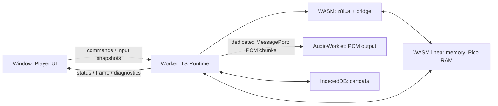
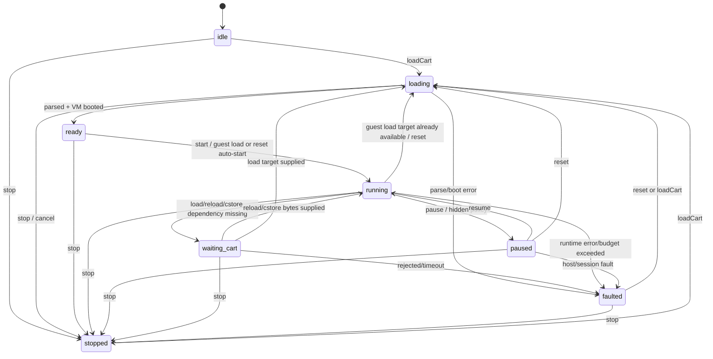

# 系统架构

## 1. 架构总览

本项目采用三执行域架构：Window 主线程、Runtime Worker、AudioWorklet。未来经许可的远端 cart resolver 属于可选外部服务，不进入 player core。



### Window 主线程

负责：

- 文件选择、drag-and-drop、controls 和 error UI。
- keyboard、pointer、gamepad、touch 状态采样。
- Canvas/WebGL 呈现和 fullscreen。
- AudioContext / AudioWorklet 生命周期。
- 建立专用 `MessageChannel`，把两个端口分别转交 Runtime Worker 与 AudioWorklet；该路径须经 Phase 0 浏览器 spike 确认。
- Worker watchdog、终止和重建。

禁止：

- 执行 cart Lua。
- 在 UI component 内实现 PICO-8 API。
- 让 DOM refresh rate 决定模拟帧数量。

### Runtime Worker

负责：

- Cart parse 和 load transaction。
- z8lua WASM lifecycle。
- Pico RAM、Cart ROM 和 Runtime state。
- frame scheduler、input edge、graphics 和 audio synthesis。
- persistence 命令与 runtime diagnostics。

Runtime Worker 是一局 player session 的唯一权威状态源。

### AudioWorklet

只负责消费已生成的 PCM、重采样/缓冲中必要的实时部分和输出。它不得拥有游戏逻辑或权威 audio/music state。

## 2. 所有权与共享内存

z8lua 的 WASM linear memory 内必须预留一块连续 64 KiB Base RAM，并导出其 pointer。TypeScript Runtime 通过 `Uint8Array` / `DataView` 建立零复制视图。

```ts
export interface PicoMemoryView {
  readonly bytes: Uint8Array;
  readonly data: DataView;
  readonly baseAddress: number;
}
```

要求：

- z8lua 的 `lua_setpico8memory()` 指向同一块地址。
- JS view 与 WASM pointer 生命周期绑定。
- v1 **MUST** 固定 WASM memory（`initial === maximum`，growth off）；Phase 0 用 heap/cart stress 确定容量。未来若要允许 growth，必须先用 ADR 修改所有权契约，并实现集中式 view identity 检查与原子重建，普通功能任务不得自行开启。
- debug/test build 可以在内部断言 `memory.buffer` identity 未改变；变化时 fail-fast 为 `E_INVARIANT`，不暴露 production refresh API。
- Cart ROM 是独立 32 KiB 逻辑对象；load/run/reload 时按规范拷贝到 Base RAM。
- Renderer 可以复制或转换 8 KiB screen region，但不得把 renderer buffer 变成 Runtime 权威状态。

官方 Base RAM 关键区间：

| 起始地址 | 区域 |
| --- | --- |
| `0x0000` | GFX |
| `0x1000` | GFX2 / MAP2 shared |
| `0x2000` | MAP |
| `0x3000` | GFX flags |
| `0x3100` | SONG |
| `0x3200` | SFX |
| `0x4300` | User data |
| `0x5600` | Custom font |
| `0x5e00` | Persistent cart data |
| `0x5f00` | Draw state |
| `0x5f40` | Hardware state |
| `0x6000` | Screen, 8 KiB |
| `0x8000` | Upper user data |

完整和更新后的解释以官方手册 Memory 章节为准。

## 3. 依赖方向

允许的依赖方向：

```text
player UI
  -> worker client protocol
    -> runtime orchestrator
      -> cart / ram / graphics / audio / input / persistence
      -> z8lua bridge
```

模块约束：

- `graphics`、`audio`、`input` 依赖 RAM interface，不依赖 UI。
- `cart` 只产生规范化 CartImage，不直接启动 VM。
- `z8lua bridge` 不导入 DOM、Canvas、AudioContext 或 IndexedDB。
- `runtime orchestrator` 是唯一允许同时协调 VM、RAM、input、graphics 和 audio 的模块。
- `player UI` 只消费协议消息，不得读取 WASM memory。

以上是概念依赖；代码级 package DAG、composition roots、public exports 和禁止 import 由 [08-source-layout-and-boundaries.md](./08-source-layout-and-boundaries.md) 唯一定义并通过 `test:architecture` 强制。其他文档不得再维护竞争性的源码目录树。

## 4. Session 状态机



状态转换必须原子化。新 cart load 失败时，不得留下旧 VM 与新 RAM 混合状态。

## 5. Worker 协议

协议必须带版本，并使用可判别 union。下面是 v1 的跨线程基线；更具体字段以 [04-typescript-runtime.md](./04-typescript-runtime.md) 为准，不能再引入 `boot`、`host-response` 等同义消息。

```ts
export type HostToRuntime =
  | { v: 1; type: "loadCart"; requestId: string; bytes: ArrayBuffer; sourceName?: string }
  | { v: 1; type: "attachAudioPort"; port: MessagePort }
  | { v: 1; type: "start" }
  | { v: 1; type: "vsync"; sequence: number; timestampMs: number }
  | { v: 1; type: "pause" }
  | { v: 1; type: "resume" }
  | { v: 1; type: "stop" }
  | { v: 1; type: "reset" }
  | { v: 1; type: "input"; snapshot: NormalizedInputSnapshot }
  | { v: 1; type: "supplyCart"; requestId: string; bytes?: ArrayBuffer; error?: SerializedRuntimeError };

export type RuntimeToHost =
  | { v: 1; type: "state"; state: RuntimeState; sessionGeneration: number }
  | { v: 1; type: "frame"; sessionGeneration: number; frameId: number; tick: string; width: 128; height: 128; rgba: ArrayBuffer }
  | { v: 1; type: "needsCart"; request: HostRequest }
  | { v: 1; type: "heartbeat"; sessionGeneration: number; tick: string; sequence?: number }
  | { v: 1; type: "diagnostic"; diagnostic: SerializedRuntimeError }
  | { v: 1; type: "fault"; error: SerializedRuntimeError };
```

协议要求：

- `ArrayBuffer` SHOULD 使用 transferable，避免复制大 buffer。
- `attachAudioPort` 的 port 必须放入 transfer list；PCM 只走该专用 port，不混入控制协议。若 Phase 0 证明目标浏览器不可靠，必须先用 ADR 改成 Window relay。
- `sessionGeneration`、`frameId`、vsync/input/audio `sequence` 和 request IDs 必须在各自作用域单调/唯一，支持丢弃 stale message。
- 未知协议版本必须失败关闭，不得猜测。
- 输入消息传 snapshot，而不是把 DOM event 原样传进 Runtime。

## 6. Boot transaction

一次 cart load 按以下顺序执行：

1. 验证输入长度和 signature。
2. 解析为不可变 `CartImage`，产生 source hash、cart version 和 diagnostics。
3. 检查版本支持策略。
4. 创建或重置 VM、Base RAM、Cart ROM、graphics/audio/input state。
5. 将 Cart ROM 规定区域复制到 Base RAM。
6. 注册受控 PICO-8 globals 和 Lua glue。
7. 编译 cart code；失败则回滚整个 transaction。
8. 以官方差分锁定的 `1/30s` clock 启动 root coroutine：若 top-level 返回，进入 callback mode 并执行 `_init()`；若先到达受控 `flip()` boundary，进入 custom-loop mode，把该 boundary 作为成功 startup，禁止再额外调用 `_init()` 或启动 callback driver。commit 时把 startup epoch 换算为 target-rate slices（30 Hz 为 1、60 Hz 为 2），但不发布 host frame event。
9. 只有全部成功后，Window `loadCart` 才把 session 提交为 `ready`；显式 `start` 后进入 `running`。guest `load()` 按官方语义在新 cart transaction 成功后自动运行。

旧 session 在新 session commit 前应保持可销毁但不可继续写入的状态。

## 7. Frame transaction

每个 logical frame 的权威顺序为：

1. scheduler 决定本次 simulation slice、callback 次数与是否 draw。
2. Runtime latch 最新 `InputSnapshot`，计算 pressed/repeat 并更新 hardware/input memory state。
3. 按 callback 模式或 custom `flip()` loop 模式推进 z8lua，直至受控 boundary。
4. 处理 VM error、instruction budget、host request 和 queued cart change。
5. 根据 logical simulation clock 生成该 slice 对应的 PCM。
6. 若本次是 visible draw/flip，读取 screen + palette/draw mode 生成 frame output。
7. 提交 diagnostics、heartbeat 和 persistence dirty state。

同一 logical frame 中 Lua API 对 RAM 的写入必须立即对后续 API 可见。

## 8. 时间模型

- Runtime 维护自己的 accumulator 和 logical simulation clock。
- `_update()` 模式逻辑速率为 30 Hz；`_update60()` 模式为 60 Hz。
- display refresh 只决定何时请求/显示最新 frame，不直接决定 update 数。
- `time()` / `t()` 必须由 logical simulation clock 推导，不等同于 callback 调用计数。官方 Web Player 差分锁定 startup 为 `1/30s`；custom main loop 的首次 `flip()` commit 这个 startup epoch，之后从 continuation 到每个受控 `flip()` 再 commit 一个 30 Hz slice。callback 60 Hz 用 2 个 target-rate slices 表示同一 startup epoch。
- scheduler 可以为追赶 wall time 执行多个 update，但必须限制最大 catch-up，避免 spiral of death。
- tab hidden 策略必须显式：默认 pause simulation 与 audio；恢复时不补跑隐藏期间的所有帧。
- 测试模式必须允许手动逐帧推进，不依赖 wall clock。

## 9. Error 模型

跨 Worker 边界只使用 [04-typescript-runtime.md 的 `SerializedRuntimeError`](./04-typescript-runtime.md#15-错误模型)。架构层不得再定义第二套错误码或字段别名；例如 instruction hook 超限使用 `E_VM_INSTRUCTION_BUDGET`，Window watchdog 终止 Worker 使用 `E_VM_WATCHDOG`。

要求：

- 用户错误与内部 invariant failure 必须区分。
- 错误消息不得泄露任意宿主路径、cookie、token 或 JS object。
- `E_INVARIANT` 必须同时产生开发日志；生产 UI 只显示安全摘要。
- Worker 无响应由 Window watchdog 转换为 `E_VM_WATCHDOG` 后重建；VM 内确定性预算超限则使用 `E_VM_INSTRUCTION_BUDGET`，两者不得混为同一故障来源。

## 10. 安全与资源限制

- Cart bytes 必须有输入大小上限；PNG 解码必须防止 decompression bomb。
- `.p8.png` 必须验证 160 × 205 和受支持的 color/bit-depth 解码结果。
- z8lua 只打开经过 allowlist 的库和 globals。
- 禁止 `io`、`os.execute`、动态 native module、任意 fetch 和 DOM interop。
- 每次 VM resume 必须有 instruction/cycle budget。
- Worker watchdog 是第二层保护，不能替代 VM budget。
- `printh` 等宿主输出必须进入受限 diagnostic sink，而非任意文件路径。
- persistence key 必须按 API 分域：`cartdata(id)` 使用校验后的显式 ID，允许官方定义的跨 cart/version 共享；`cstore` overlay 才绑定规范化 cart identity。两者不得共用 key space。

## 11. 初始性能预算

以下是 Phase 0 要验证的工程预算，不是未经测试的兼容承诺：

- 60 Hz logical frame 总预算为 16.67 ms。
- desktop 基准环境中，VM + TS Runtime 的 p95 SHOULD 不超过 8 ms/frame。
- 主线程 frame present 的 p95 SHOULD 不超过 4 ms。
- input-to-logical-update latency MUST 不超过 1 logical frame（不含浏览器显示延迟）。
- Runtime 与 renderer 之间不得每帧复制超过必要的 128 × 128 RGBA/frame payload。
- 稳态运行不得产生与运行时长线性增长的未回收消息或 buffer。

基准失败时按照 [07-decisions-risks-open-questions.md](./07-decisions-risks-open-questions.md) 的 fallback ladder 调整边界。
