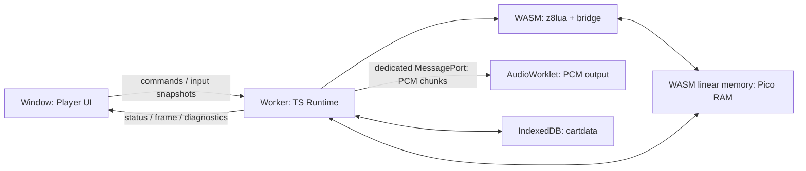
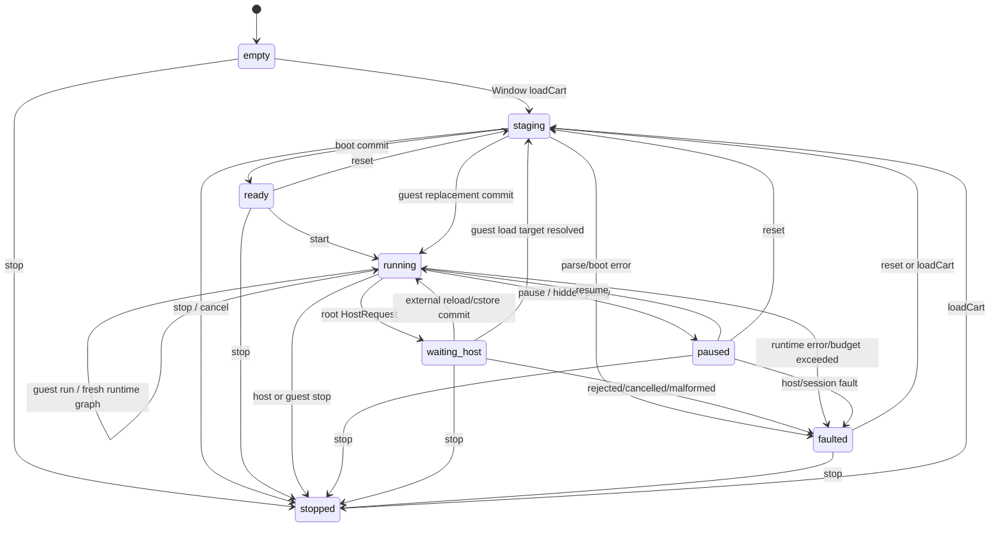

# 系统架构

> 文档角色：稳定的系统边界与目标拓扑。当前实现状态以机器契约、源码、自动测试和
> [最近关闭的机器合同](../spec/phase-5-l3-multicart-contract.json)为准。

## 状态路由

| 状态 | 本文内容 |
| --- | --- |
| **Accepted** | 三执行域、状态唯一所有权、依赖方向、固定 Pico RAM 和资源上限原则 |
| **Implemented** | 三执行域 production path；versioned bytes-first embed facade；stable-manifest release artifact；class-driven production DOM shell；caller-authorized local CartLoader/resolver/repository 与 non-recursive text include；root HostRequest；atomic guest `load`；external `reload/cstore`；deterministic CPU policy；fixed 16 MiB WASM、64 KiB Pico RAM 与 bounded lifecycle |
| **Deferred** | general nested-coroutine HostRequest、BBS/network resolver、非 Chrome qualification 和未激活的 capability/API 扩展 |

第 4–11 节只维护稳定架构约束，不复制容易漂移的 DTO 和 error union。当前 production player
协议由 [`player-protocol.ts`](../apps/web-player/src/transport/player-protocol.ts) 定义；最近关闭
能力由 [`phase-5-l3-multicart-contract.json`](../spec/phase-5-l3-multicart-contract.json) 及其
前置合同锁定。早期 `worker-protocol.ts` 只保留为兼容 probe。已实现的 browser boundary 由
[`phase-0f-browser-boundary.json`](../spec/phase-0f-browser-boundary.json)、ADR-009 和 ADR-010
定义。

## 1. 架构总览

本项目采用三执行域架构：Window 主线程、Runtime Worker、AudioWorklet。未来经许可的远端 cart resolver 属于可选外部服务，不进入 player core。



### Window 主线程

负责：

- 文件选择、drag-and-drop、controls 和 error UI。
- keyboard、pointer、gamepad、touch 状态采样。
- Canvas/WebGL 呈现和 fullscreen。
- AudioContext / AudioWorklet 生命周期。
- 建立专用 `MessageChannel`，把两个端口分别转交 Runtime Worker 与 AudioWorklet；
  [ADR-010](./adr/010-dedicated-messageport-audio-transport.md) 已接受该唯一默认路径。
- Worker watchdog、终止和重建。
- versioned embed lifecycle 和 typed event facade；public consumer 不直接依赖 Worker transport DTO。

禁止：

- 执行 cart Lua。
- 在 UI component 内实现 PICO-8 API。
- 让 DOM refresh rate 决定模拟帧数量。

### Runtime Worker

负责：

- Cart parse 和 load transaction。
- z8lua WASM lifecycle。
- Pico RAM、Cart ROM 和 Runtime state。
- frame scheduler、input edge、graphics 和 audio synthesis。
- persistence 命令与 runtime diagnostics。

Runtime Worker 是一局 player session 的唯一权威状态源。

### AudioWorklet

只负责消费已生成的 PCM、重采样/缓冲中必要的实时部分和输出。它不得拥有游戏逻辑或权威 audio/music state。

### Stable embed facade

`@pico8-web/web-player` 的单一 package root 是 Window execution domain 的稳定消费入口。它只接受
caller-provided `Uint8Array` 与 bounded caller-authorized local bundle；不接受 cart URL，也不执行
cart discovery 或 implicit fetch。公开 embed lifecycle 为 `create/loadCart/start/pause/resume/reset/stop/dispose`；
默认 shell 另以 private versioned transport 提供 `openPauseMenu/closePauseMenu/invokeMenuItem`，
公开事件只包含 copy-owned `state/frame/diagnostic/fault`，不把 app-owned Worker DTO 作为 consumer contract。

所有 mutating lifecycle operation 在每个 facade 实例内串行化。`dispose()` 是 idempotent terminal
barrier：立即拆除 public listener、controller listener、presenter 和 audio output path；尚未开始的操作
fail closed，in-flight completion 不得再提交 frame、audio、state 或 diagnostic。每个 `create()` 构造独立
Worker、presenter、input、AudioContext/Worklet 和 persistence adapter object graph；模块级不得保存 mutable
player singleton。

### Release artifact discovery

静态发布包由 [`spec/release-artifact-contract.json`](../spec/release-artifact-contract.json) 定义；
`manifest.json` 是唯一公开 discovery surface，稳定 key 为 `main/worker/worklet/wasm/styles/demo`。
key 指向的相对 path、hash、byte length、MIME 和 provenance 由 verifier fail closed 校验，实际文件名和
目录深度仍是 build detail。main facade 以自身 `import.meta.url` 解析 package-owned Worker/Worklet，
Worker 再以相邻 Emscripten loader 定位 WASM，因此相同 bytes 可部署到任意 nested same-origin base。

发布 profile 不要求 cross-origin isolation。正确 `application/wasm` 使用 streaming instantiate；错误
MIME 由 Emscripten 回退到 ArrayBuffer。严格 CSP 只额外开放 WebAssembly 所需的
`'wasm-unsafe-eval'`，不得开放 `'unsafe-eval'`、inline script、任意网络 cart 或 caller-supplied
Worker/WASM URL。release builder 只拥有 packaging，不取得 Runtime、cart 或网络 authority。

### Production DOM shell

默认 shell 的 DOM structure、状态文案、control availability、local file preflight、integer-scale policy 和
responsive/fullscreen presentation 由 `main/ui` 所有；`PlayerController` 只把 UI intent 映射到稳定
lifecycle。shell 只接受用户明确选择或 drop 的单个 bounded `.p8`/`.p8.png` 文件，不接受 URL、目录、
clipboard 或隐式 network authority。

`idle/loading/ready/running/audio-blocked/menu-open/paused/stopped/faulted/disposed` 都有独立 DOM state。无手势的
AudioContext 恢复失败只进入可恢复 `audio-blocked`，不升级为 cart fault；visual simulation 可以继续，
用户可再次解锁、静音运行或替换 cart。Canvas backing store 固定 128×128，CSS 只选择容器可容纳的整数
scale；DPR、ResizeObserver 和 fullscreen 不进入 simulation input。

文件 controls、status、diagnostic、touch buttons 和 cart pause menu 都位于 Canvas 外。keyboard/touch
输入只在可玩状态启用，blur/visibility/dispose 清除 transient input；reduced-motion、ARIA live/pressed/
disabled state 和至少 44 CSS px touch target 属于同一 shell contract。样式由 release stylesheet、class
和 data attributes 驱动，production source 不写 inline layout style。

## 2. 所有权与共享内存

z8lua 的 WASM linear memory 内必须预留一块连续 64 KiB Base RAM，并导出其 pointer。TypeScript Runtime 通过 `Uint8Array` / `DataView` 建立零复制视图。

跨 package 只传 runtime-neutral `PicoMemoryLease`；精确字段由
[`packages/contracts/src/public.ts`](../packages/contracts/src/public.ts) 定义，不暴露
`WebAssembly.Memory`、Emscripten module 或 raw handle。

要求：

- z8lua 的 `lua_setpico8memory()` 指向同一块地址。
- JS view 与 WASM pointer 生命周期绑定。
- v1 **MUST** 固定 WASM memory（`initial === maximum`，growth off）；当前容量已由 heap/cart stress 锁定。未来若要允许 growth，必须先用 ADR 修改所有权契约，并实现集中式 view identity 检查与原子重建，普通功能任务不得自行开启。
- debug/test build 可以在内部断言 `memory.buffer` identity 未改变；变化时 fail-fast 为 `E_INVARIANT`，不暴露 production refresh API。
- Cart ROM 是独立 32 KiB 逻辑对象；load/run/reload 时按规范拷贝到 Base RAM。
- Renderer 可以复制或转换 8 KiB screen region，但不得把 renderer buffer 变成 Runtime 权威状态。

官方 Base RAM 关键区间：

| 起始地址 | 区域 |
| --- | --- |
| `0x0000` | GFX |
| `0x1000` | GFX2 / MAP2 shared |
| `0x2000` | MAP |
| `0x3000` | GFX flags |
| `0x3100` | SONG |
| `0x3200` | SFX |
| `0x4300` | User data |
| `0x5600` | Custom font |
| `0x5e00` | Persistent cart data |
| `0x5f00` | Draw state |
| `0x5f40` | Hardware state |
| `0x6000` | Screen, 8 KiB |
| `0x8000` | Upper user data |

完整和更新后的解释以官方手册 Memory 章节为准。

## 3. 依赖方向

允许的依赖方向：

```text
player UI
  -> worker client protocol
    -> runtime orchestrator
      -> cart / ram / graphics / audio / input / persistence
      -> z8lua bridge
```

模块约束：

- `graphics`、`audio`、`input` 依赖 RAM interface，不依赖 UI。
- `cart` 只产生规范化 `ParsedCart`，不直接启动 VM。
- `z8lua bridge` 不导入 DOM、Canvas、AudioContext 或 IndexedDB。
- `runtime orchestrator` 是唯一允许同时协调 VM、RAM、input、graphics 和 audio 的模块。
- `player UI` 只消费协议消息，不得读取 WASM memory。

以上是概念依赖；代码级 package DAG、composition roots、public exports 和禁止 import 由 [08-source-layout-and-boundaries.md](./08-source-layout-and-boundaries.md) 唯一定义并通过 `test:architecture` 强制。其他文档不得再维护竞争性的源码目录树。

## 4. Session 状态机

> 状态：Implemented。对外状态以 `player-protocol.ts` 的
> `ready/running/waiting-host/paused/stopped/disposed` 为准；staging 与 fault containment 是
> Worker 内部事务状态，不额外扩张 wire protocol。



状态转换必须原子化。guest `load()` 只有在独立 staged session 成功 boot 后才替换 generation，
且 `session-replaced` 必须是新 generation 的第一个 event；失败时不得发布 staging frame/audio，
也不得留下旧 VM 与新 RAM 混合状态。

## 5. Worker 协议

> 状态：Implemented。精确字段、validator 和 transfer ownership 只以
> [`player-protocol.ts`](../apps/web-player/src/transport/player-protocol.ts) 及同目录 source 为准，
> 本文不维护第二份协议 union。

v1 Window → Worker 包含 `loadCart`（可携带 caller-authorized local bundle）、
`start/vsync/pause/resume/reset/stop/dispose`、`openPauseMenu/closePauseMenu/invokeMenuItem`、versioned input 与 persistence flush；Worker → Window
包含 `session-replaced`、state/frame/heartbeat/runtime-control/diagnostic/fault。root HostRequest
属于 Worker 内部 RuntimeCore port，不把 resolver request/completion 绕到 Window。

协议要求：

- `ArrayBuffer` SHOULD 使用 transferable，避免复制大 buffer。
- `attachAudioPort` 的 port 必须放入 transfer list；PCM 只走该专用 port，不混入控制协议。
  Window relay 和 SAB 已被 ADR-010 拒绝为默认 fallback；改变路径必须有新 evidence 并取代该 ADR。
- `sessionGeneration`、`frameId`、vsync/input/audio `sequence` 和 request IDs 必须在各自作用域单调/唯一，支持丢弃 stale message。
- 未知协议版本必须失败关闭，不得猜测。
- 输入消息传 snapshot，而不是把 DOM event 原样传进 Runtime。

## 6. Boot transaction

> 状态：Implemented；覆盖 Window load/reset、guest root `load()` 的独立 staging 和
> caller-authorized local resolution。

一次 cart load 按以下顺序执行：

1. 验证输入长度和 signature。
2. 使用当前 load command 显式授权的 Worker-local bundle 展开一层 text `#include`，再解析为不可变
   `ParsedCart`，产生 source hash、cart version 和 diagnostics；codec 不自行访问 URL/filesystem。
3. 检查版本支持策略。
4. 创建或重置 VM、Base RAM、Cart ROM、graphics/audio/input state。
5. 将 Cart ROM 规定区域复制到 Base RAM。
6. 注册受控 PICO-8 globals 和 Lua glue。
7. 编译 cart code；失败则回滚整个 transaction。
8. 以官方差分锁定的 `1/30s` clock 启动 root coroutine：若 top-level 返回，进入 callback mode 并执行 `_init()`；若先到达 root `flip()` 或 [ADR-022](./adr/022-cpu-slicing-decision.md) 的 implicit boundary，进入 30 Hz custom-loop mode并把它作为成功 startup。有限 top-level 若在后续 frame 最终返回，才至多执行一次 `_init()` 并切换 callback driver。commit 时把 startup epoch 换算为 target-rate slices（30 Hz 为 1、60 Hz 为 2），但不发布 host frame event。
9. 只有全部成功后，Window `loadCart` 才把 session 提交为 `ready`；显式 `start` 后进入
   `running`。guest `run(param)` 使用 retained current cart 创建 fresh runtime graph，并在同一
   player session 中继续 `running`。guest `load()` 则解析 caller-authorized ref、boot 独立 staged
   session，并在成功时用 `session-replaced` 原子提交新 generation。

旧 session 在新 session commit 前必须停止继续 step；staging 失败时旧 session 进入 fault
containment，不恢复已被 `load()` 放弃的执行路径。

## 7. Frame transaction

> 状态：Implemented；input → VM → CPU classification → audio/frame → persistence 的 committed
> transaction；root HostRequest 通过 `waiting-host` 暂停 logical clock，并在通过 generation、
> request 和 cancellation 检查后恢复或替换 session。

每个 logical frame 的权威顺序为：

1. scheduler 决定本次 simulation slice、callback 次数与是否 draw。
2. Runtime latch 最新 `InputSnapshot`，计算 pressed/repeat 并更新 hardware/input memory state。
3. 按 callback 模式或 custom main-loop 模式推进 z8lua，直至 callback frame-end、root `flip()` 或
   root-safe implicit-frame boundary。
4. 累计 deterministic z8lua instruction cost，处理 VM error、safety hard cap、host request 和
   queued cart change；普通 CPU 超预算 transaction 继续原子完成，并在公开 frame 上标记
   `slowFrame`，不会冒充 VM fault。
5. 根据 logical simulation clock 生成该 slice 对应的 PCM。
6. 若本次是 visible draw/flip，读取 screen + palette/draw mode 生成 frame output。
7. 提交 diagnostics、heartbeat 和 persistence dirty state。

同一 logical frame 中 Lua API 对 RAM 的写入必须立即对后续 API 可见。

## 8. 时间模型

> 状态：Implemented；覆盖 startup/manual slice、bounded interactive scheduler 与 deterministic
> slow-frame classification；资源验证不改变 guest cadence。

- Runtime 维护自己的 accumulator 和 logical simulation clock。
- `_update()` 模式逻辑速率为 30 Hz；`_update60()` 模式为 60 Hz。
- display refresh 只决定何时请求/显示最新 frame，不直接决定 update 数。
- `time()` / `t()` 必须由 logical simulation clock 推导，不等同于 callback 调用计数。官方 Web Player 差分锁定 startup 为 `1/30s`；custom main loop 的首次 explicit `flip()` 或 implicit-frame boundary commit 这个 startup epoch，之后每个受控 custom boundary 再 commit 一个 30 Hz slice。callback 60 Hz 用 2 个 target-rate slices 表示同一 startup epoch。
- scheduler 最多追赶 5 ticks/vsync；超出后丢弃 backlog 并发出
  `E_TIME_DISCONTINUITY`，避免 spiral of death。
- [ADR-011](./adr/011-hidden-tab-pause.md) 已锁定默认 hidden/blur pause：清输入并重建
  scheduler anchor，恢复时不补跑隐藏期间的所有帧。
- 测试模式必须允许手动逐帧推进，不依赖 wall clock。
- guest CPU fraction 为 `floor(instructions * accountingFps * 65536 / 4,000,000)`；普通 frame
  的 `accountingFps` 等于 logical target FPS，固定 `1/30s` startup transaction 始终为 30（60 Hz
  cart 的 startup clock 提交两个 slice）。raw `0x00010000` 是 100%，只有大于该值才标记
  `slowFrame`。host wall-clock 不参与此结果。

## 9. Error 模型

跨 Worker 边界只使用 [04-typescript-runtime.md 的 `SerializedRuntimeError`](./04-typescript-runtime.md#15-错误模型)。架构层不得再定义第二套错误码或字段别名；例如 instruction hook 超限使用 `E_VM_INSTRUCTION_BUDGET`，Window watchdog 终止 Worker 使用 `E_VM_WATCHDOG`。

要求：

- 用户错误与内部 invariant failure 必须区分。
- 错误消息不得泄露任意宿主路径、cookie、token 或 JS object。
- `E_INVARIANT` 必须同时产生开发日志；生产 UI 只显示安全摘要。
- Worker 无响应由 Window watchdog 转换为 `E_VM_WATCHDOG` 后重建；VM 内确定性预算超限则使用 `E_VM_INSTRUCTION_BUDGET`，两者不得混为同一故障来源。

## 10. 安全与资源限制

- Cart bytes 必须有输入大小上限；PNG 解码必须防止 decompression bomb。
- `.p8.png` 必须验证 160 × 205 和受支持的 color/bit-depth 解码结果。
- z8lua 只打开经过 allowlist 的库和 globals。
- 禁止 `io`、`os.execute`、动态 native module、任意 fetch 和 DOM interop。
- 每次 VM resume 必须有 instruction/cycle budget。
- Worker watchdog 是第二层保护，不能替代 VM budget。
- `printh` 等宿主输出必须进入受限 diagnostic sink，而非任意文件路径。
- persistence key 必须按 API 分域：`cartdata(id)` 使用校验后的显式 ID，允许官方定义的跨 cart/version 共享；`cstore` overlay 才绑定规范化 cart identity。两者不得共用 key space。

## 11. 性能预算基线

以下预算已由 deterministic CPU oracle 和 1800 秒 Chrome 长稳重新校准；
它们仍只构成当前 Chrome desktop project profile，不外推为其他平台承诺：

- 60 Hz logical frame 总预算为 16.67 ms。
- desktop 基准环境中，VM + TS Runtime 的 p95 SHOULD 不超过 8 ms/frame。
- 主线程 frame present 的 p95 SHOULD 不超过 4 ms。
- input-to-logical-update latency MUST 不超过 1 logical frame（不含浏览器显示延迟）。
- Runtime 与 renderer 之间不得每帧复制超过必要的 128 × 128 RGBA/frame payload。
- 稳态运行不得产生与运行时长线性增长的未回收消息或 buffer。

production resource contract 固定为 16 MiB WASM、64 KiB Pico RAM、默认 2 MiB
Lua heap；受限 diagnostic profile 必须以 `E_VM_OOM` fail closed。Lua heap 调整不改变 fixed WASM
memory，也不允许 per-cart/adaptive sizing；边界见 [ADR-026](./adr/026-phase-9-language-compatibility-boundary.md)。AudioWorklet source queue
capacity/high-water 为 `66,150/44,100` frames，cartdata hydrate 上限为 4,096 records / 1 MiB。
主页面 retained heap 的硬门禁使用 CDP 强制 GC 后的 isolate 值；`performance.memory` 只作趋势诊断。

基准失败时按照 [07-decisions-risks-open-questions.md](./07-decisions-risks-open-questions.md) 的 fallback ladder 调整边界。
