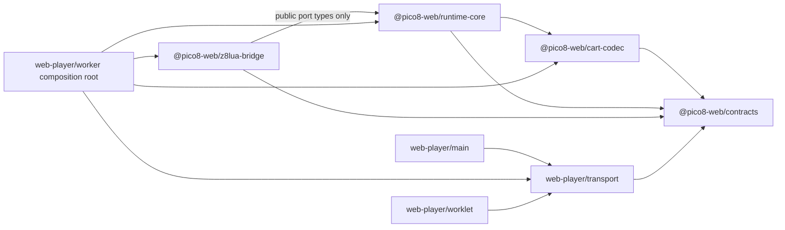

# 源码目录与边界契约

> 状态：v1 canonical source layout
> 适用范围：所有 production source、WASM source、生成物、测试与构建工具

## 状态路由

| 状态 | 本文内容 |
| --- | --- |
| **Implemented** | 四个 package；main/transport/worker/worklet execution-domain 边界；package exports；browser-neutral RuntimeCore；WASM/Canvas/Audio/IndexedDB adapters；CartLoader/local resolver/repository；architecture negative tests；`ref/` quarantine |
| **Scaffold** | 其余未激活 adapter 文件位；文件存在不代表功能完成 |
| **Target** | 本文目录树中的其余文件、ports 和 adapters；创建前仍需由当前阶段范围授权 |
| **Accepted ownership** | presenter 属于 `apps/web-player/src/main`，audio DTO 属于 `transport`，Worker producer 属于 `worker`，device queue 属于 `worklet`；不得把浏览器 adapter 放入 RuntimeCore |

目录树是归属契约，不是“文件全部存在”的清单。当前 source truth 是实际文件、package exports、
TypeScript project references 和 architecture tests；阶段完成历史只在
[`evidence/`](./evidence/) 与机器合同中保存。Phase 5 已关闭 guest root `load`、caller-authorized
local resolver 和 multicart；不得因为 scaffold 或 Target 路径存在就接入任意 URL、文件系统、BBS
或新的 host authority。AudioContext、IndexedDB、Canvas 和 browser input 始终属于 app adapters，
RuntimeCore 保持 browser-neutral。

本文是源码归属和 import 方向的唯一事实来源。概念架构以 [02-system-architecture.md](./02-system-architecture.md) 为准，模块行为以 [03-z8lua-wasm-bridge.md](./03-z8lua-wasm-bridge.md) 和 [04-typescript-runtime.md](./04-typescript-runtime.md) 为准；本文件决定这些概念在仓库中放在哪里，以及哪些依赖在代码层合法。

目录美观不是目标。目标是让以下约束能够被 TypeScript project references、package `exports` 和自动化依赖图测试强制执行：

- simulation/runtime core 不依赖浏览器、renderer、Worker transport 或 z8lua 具体实现。
- Window、Runtime Worker、AudioWorklet 三个执行域不能通过随意 import 合并成一个隐式进程。
- z8lua、IndexedDB、Canvas/WebGL、AudioWorklet 都是边界 adapter，不成为权威游戏状态所有者。
- 每个跨边界接口有唯一 owner、唯一公共入口和可替换 test double。

## 1. Canonical workspace

项目采用单仓库 workspace。当前 profile 不把所有代码塞入一个 `src/`，也不为每个小类创建
package；package 只用于强制真正的架构边界。

```text
.
├── apps/
│   └── web-player/
│       ├── src/
│       │   ├── transport/
│       │   │   ├── player-protocol.ts
│       │   │   ├── worker-protocol.ts
│       │   │   ├── audio-protocol.ts
│       │   │   └── validators.ts
│       │   ├── main/
│       │   │   ├── public.ts
│       │   │   ├── embed-player.ts
│       │   │   ├── main.ts
│       │   │   ├── compose-player.ts
│       │   │   ├── player-controller.ts
│       │   │   ├── player-runtime-client.ts
│       │   │   ├── runtime-client.ts
│       │   │   ├── input-frontend.ts
│       │   │   ├── gamepad-input.ts
│       │   │   ├── touch-input.ts
│       │   │   ├── player-input.ts
│       │   │   ├── devkit-input.ts
│       │   │   ├── render/
│       │   │   └── ui/
│       │   ├── worker/
│       │   │   ├── player-worker-entry.mjs
│       │   │   ├── runtime-worker.ts
│       │   │   ├── compose-runtime.ts
│       │   │   └── adapters/
│       │   │       ├── indexeddb-persistence-adapter.ts
│       │   │       ├── host-cart-resolver-adapter.ts
│       │   │       └── cart-repository-adapter.ts
│       │   └── worklet/
│       │       ├── pico8-audio-processor.ts
│       │       └── pcm-queue.ts
│       ├── public/
│       │   ├── player.css
│       │   └── demo/
│       ├── dist/release/            # ignored, reproducible static release output
│       └── package.json
├── packages/
│   ├── contracts/
│   │   ├── src/
│   │   │   ├── values/
│   │   │   ├── errors/
│   │   │   └── public.ts
│   │   └── package.json
│   ├── cart-codec/
│   │   ├── src/
│   │   │   ├── model/
│   │   │   ├── p8/
│   │   │   ├── p8png/
│   │   │   ├── compression/
│   │   │   └── public.ts
│   │   └── package.json
│   ├── runtime-core/
│   │   ├── src/
│   │   │   ├── session/cart-session.ts
│   │   │   ├── memory/
│   │   │   ├── graphics/l1-graphics.ts
│   │   │   ├── audio/
│   │   │   ├── input/l1-input.ts
│   │   │   ├── scheduler/frame-scheduler.ts
│   │   │   ├── persistence/
│   │   │   ├── pico-api/pico-api-host.ts
│   │   │   ├── ports/
│   │   │   ├── frame-runtime.ts
│   │   │   └── public.ts
│   │   └── package.json
│   └── z8lua-bridge/
│       ├── src/
│       │   ├── generated/
│       │   ├── memory-view.ts
│       │   ├── wasm-loader.ts
│       │   ├── z8lua-vm-adapter.ts
│       │   └── public.ts
│       └── package.json
├── spec/
│   ├── pico-api-inventory.yaml
│   └── abi/
├── wasm/
│   ├── z8lua/
│   ├── bridge/
│   ├── patches/
│   ├── manifest.lock.json
│   └── dist/
├── tests/
│   ├── architecture/
│   ├── unit/
│   │   ├── contracts/
│   │   ├── cart-codec/
│   │   ├── runtime-core/
│   │   └── z8lua-bridge/
│   ├── contract/
│   │   ├── wasm-abi/
│   │   └── worker-protocol/
│   ├── conformance/
│   ├── golden/
│   ├── differential/
│   ├── integration/
│   ├── browser/
│   ├── performance/
│   ├── fuzz/
│   ├── fixtures/
│   └── external-corpus.example.json
├── tools/
│   ├── release/                     # deterministic builder + fail-closed artifact verifier
│   └── browser/                     # Chrome/Chromium gates; never a cart/network authority
├── docs/
├── ref/                       # gitignored local reference clones; never a build input
├── pnpm-workspace.yaml
└── package.json
```

文件名可以在实现时细化，但顶层 package、执行域、依赖方向和公共入口不能在普通功能任务中随意变化。

## 2. Package 职责

### `@pico8-web/contracts`

只包含跨 package/执行域稳定值类型和可序列化错误数据，例如 raw Q16.16、P8 byte string view、`CartIdentity`、`RuntimeState`、`NormalizedInputSnapshot`、`HostRequest`、`SerializedRuntimeError` 和 determinism IDs。

约束：

- 不包含 stateful class、scheduler、parser、I/O、浏览器 global 或 z8lua 类型。
- 不定义 `MessagePort`、DOM event 等 Web transport 类型；它们属于 app 的 `transport/`。
- `RuntimeCommand`、`RuntimeEvent`、frame/audio transferable DTO 仍属于 app transport；contracts 只提供其中跨 core/main 共享的稳定字段类型，防止 main 为复用一个 type 而依赖 RuntimeCore。
- 不成为 `utils/common/shared` 垃圾桶。一个类型只有被两个以上合法上层 consumer 共享、且语义稳定时才进入此 package。
- 稳定值包括 `PICO_RAM_SIZE`、runtime-neutral `PicoMemoryLease`、`PicoInputSnapshot`、
  `SerializedRuntimeError` 和只含 raw-input `contentSha256` 的 `CartIdentity`。
- lease 不携带 WASM/module/handle；display name、locator、origin/resolver metadata 不属于 content identity；
  versioned Worker command/event 仍留在 app transport。

### `@pico8-web/cart-codec`

负责纯 bytes → immutable-record `ParsedCart`：`.p8`、`.p8.png`、code decompression、
section packing、校验和诊断。当前 bytes-magic `decodeCart`、text `decodeP8`
和 lossless `decodeP8Png`，两种格式统一返回 content identity、32 KiB ROM、P8SCII code、
version 和 warnings。typed arrays 是独立 caller-owned snapshots，由 consumer 只读对待；
CartLoader/resolver/repository 位于 RuntimeCore 与 Worker adapter，不能反向塞进 codec；include
resolution 仍 Deferred。

允许依赖：`@pico8-web/contracts`。
禁止依赖：RuntimeCore、z8lua bridge、DOM、Canvas、File API、IndexedDB、网络 resolver。

`CartSource` 的 bytes 由调用方提供；codec 不自行取得资源。

text/PNG/code internals 只在 package 内部，public consumer 只能从 package
root 取得 typed API 与 `CartCodecError`。`spec/cart-codec-contract.json` 锁定格式、
limits/error inventory，`packages/cart-codec/manifest.lock.json` 锁定 source hashes、
runtime dependency、fixture ownership 与 reference provenance；统一 verify 会验证二者。

### `@pico8-web/runtime-core`

最终拥有 player simulation 和 session 权威状态。当前公共实现分为
`frame-runtime.ts`、`session/cart-session.ts`、`graphics/l1-graphics.ts`、
`graphics/map-memory.ts`、`graphics/p8scii-text.ts`、`graphics/p8scii-font.ts`、
`memory/pico-ram.ts`、`cart/cart-loader.ts`、`cart/guest-cart-request.ts`、
`cart/external-cart-data-request.ts`、`audio/sfx-synth.ts`、`input/l1-input.ts`、
`persistence/cart-data-core.ts`、`scheduler/frame-scheduler.ts`、
`pico-api/pico-api-host.ts` 和只负责
re-export 的 `public.ts`。
`FrameSliceRuntime` + `FrameVmPort` + browser-neutral `PicoApiHost` 拥有单 generation 的
frame/time/HostRequest transaction、canonical logical RAM access 与 standard-4bpp draw-state/sprite/map/tline graphics/input；`CartSession` 通过 RuntimeCore-owned
runtime factory port 拥有 cart snapshot、generation、cold reset、stale response 和
fault/stop/dispose lifecycle；`FrameScheduler` 拥有 wall-clock accumulator/catch-up policy，但
不拥有 clock source 或 simulation。`PicoSfxSynth` 从同一 physical Pico RAM live-read SFX/song，
由 committed logical slices 生成 browser-neutral canonical PCM；visual/custom-font 与同步 audio
P8SCII 都落在 RuntimeCore。Worker 只把 startup/frame PCM 交给 app-owned dedicated transport，
AudioWorklet 独占 device queue/resampling。固定八玩家/devkit latch 已在 core，keyboard/Gamepad/touch
device mapping 已在 app。package-private `CartDataCore` 从 prehydrated seed 复制到 live
`0x5e00..0x5eff`，并只在 committed boot/frame 输出 copy-owned dirty snapshot；browser-neutral
`CartDataPersistencePort` 由 Worker-owned IndexedDB adapter 实现，RuntimeCore 不依赖 storage API。
browser-neutral `CartResolverPort`、`CartRepositoryPort`、`RootHostRequestHandlerPort`、
`CurrentCartDataRepositoryPort` 与 Worker-local bounded copy-on-write overlay 已完成。

允许依赖：`@pico8-web/contracts`、`@pico8-web/cart-codec`。
禁止依赖：`@pico8-web/z8lua-bridge`、`apps/`、Worker API、Canvas/WebGL、AudioContext、IndexedDB、File API、`fetch()`。

所有 core 所需外部能力由 `ports/` 定义。Port contract 由 RuntimeCore package 拥有，concrete adapter 在外层实现：

- outbound `VmPort`：compile/resume/reset/destroy、runtime-neutral `PicoMemoryLease`、
  `PicoLogicalMemoryPort` 与错误/request 读取；真实 `WebAssembly.Memory`、module 和 handle
  不越过 adapter 边界。
- inbound `PicoApiHost`：RuntimeCore 暴露给 VM adapter 的同步 PICO API surface。
- outbound `CartDataPersistencePort`：hydrate/enqueue/flush/diagnostics/dispose。
- outbound `CartResolverPort`：把 opaque ref 解析为 caller-authorized cart bytes/capability，不暴露任意 URL fetch。
- outbound `CurrentCartDataRepositoryPort`：管理当前 cart 的受保护 data ROM 读取和 copy-on-write overlay；adapter 必须重复范围/capability 检查。
- outbound sinks：frame、diagnostic、heartbeat；设备 transport 不反向驱动 simulation。

### `@pico8-web/z8lua-bridge`

实现 RuntimeCore 定义的 `VmPort`，封装 Emscripten loader、WASM handle、raw ABI、pointer lifetime、instruction budget 和 generated bindings。

允许依赖：`@pico8-web/contracts`、`@pico8-web/runtime-core` 的显式 public port types、WASM artifact。对 RuntimeCore 的依赖必须是 `import type`；bridge 运行时不得加载 core implementation。
禁止依赖：cart parser、graphics/audio 实现、UI、IndexedDB、Canvas、AudioContext、网络。

Production adapter 包含 session-local `PicoApiHostRouter`、package-private linear-memory binding 和
RuntimeCore-owned `PicoLogicalMemoryPort` 实现。module-local dispatcher 只按 binding id 路由，不保存
跨 module delegate；每次 memory map 检查 lease freshness 并调用 canonical mapper。generated
80-byte call frame 复用固定 scalar scratch，byte string view 只在同步调用期间借用；bridge 只做
Lua stack/presence/boolean/Q16/string lowering，不复制 graphics、audio、input 或 persistence 语义。

Host bindings `1..41` 保持 append-only；`rrect/rrectfill` 为 `39..40`，system-register-only `reset`
为 `41`。guest `run/stop` 使用 VM control outcome，不占 binding id。VM-local table/string/random
helpers 位于 `p8w_pico8_compat.*`，table/function handle 不进入 TypeScript，PRNG state 位于 shared
Pico RAM。`menuitem()` 的 bounded 五槽 registry、byte label 与 callback strong reference 也由当前
`lua_State` 独占；ADR-023 的 fixed copy snapshot/root-safe invoke 由 bridge adapter 暴露给 RuntimeCore，
但任何 Lua handle 都不离开 VM。Worker 独占 menu-open/generation authority，Main 的 DOM dialog 只渲染
copied slots；host lifecycle pause 不消费或伪装 guest callback。
精确 operation 列表只以 `spec/abi/` 和生成 manifest 为准。

明确命名的 Phase 0 memory bindings 和 `p8w0c_bench_*` 只属于隔离 probe；不得进入
`z8lua-runtime-v1` artifact、production adapter interface 或 RuntimeCore。

RuntimeCore **MUST NOT** 反向 import 此 package。具体 adapter 只在 Worker composition root 注入。

### `apps/web-player`

这是产品 application shell 和唯一浏览器集成层，不是可被 packages 反向复用的 library。

- `transport/`：只放 Window ↔ Worker 与 Worker ↔ AudioWorklet 的 versioned structured-clone DTO、validator 和 transfer-list helper；不得放状态机或业务逻辑。
- `main/`：DOM/UI、输入设备采样与 physical→normalized action mapping、Canvas/WebGL presenter、AudioContext 生命周期、Worker watchdog 和 `RuntimeClient`。其中 `main/ui/` 只拥有 DOM view、derived control policy、bounded local-file preflight 和 integer-scale presentation；`PlayerController` 映射 intent 到 lifecycle，二者都不得复制 Worker simulation 状态机或读取 WASM/Pico RAM。
- `worker/`：Runtime Worker entrypoint、消息适配、IndexedDB/repository adapters，以及唯一的 `compose-runtime.ts`。
- `worklet/`：PCM queue、重采样所需的实时设备逻辑和 processor 注册；不得 import RuntimeCore 或 z8lua。

`apps/web-player` 可以依赖 packages；任何 package **MUST NOT** import `apps/web-player`。

`public/` 只保存 release-owned static source（stylesheet 与 local-bytes demo），不保存 cart、截图或
runtime state。`tools/release/` 是唯一 packaging composition root：它从 tracked source、编译输出和
锁定 WASM 输入生成 ignored `dist/release/`，并按
[`spec/release-artifact-contract.json`](../spec/release-artifact-contract.json) 校验精确 allowlist、hash、
length、MIME、CSP 与 provenance。release tool 可以组合 execution-domain artifacts，但不得成为任何
production package 的 import dependency，也不得读取 `ref/`、local corpus 或网络 cart。

`player-worker-entry.mjs` 是异步 WASM bootstrap/bundle entry：它必须先调用
`installPlayerRuntimeWorker` 注册 message listener，再等待 WASM/controller promise；esbuild 只
解析 workspace specifier 生成 Chrome Module Worker artifact，不改变 execution-domain ownership。

## 3. 依赖 DAG



额外约束：

- `main/` 不得 import RuntimeCore、cart codec 或 z8lua bridge；它只发送 bytes/commands、接收 frames/status。
- `worklet/` 不得 import RuntimeCore、cart codec、z8lua bridge 或 `main/`。
- `worker/` 是唯一可以同时 import RuntimeCore、cart codec、z8lua bridge 和 Worker adapters 的 execution-domain composition root。
- production package graph 必须无环。测试可以 import 多个 package 做集成，但不得被 production source import。

## 4. Composition roots 与实例生命周期

只有以下文件允许实例化跨边界 concrete adapter：

- `apps/web-player/src/main/compose-player.ts`
- `apps/web-player/src/worker/compose-runtime.ts`
- `apps/web-player/src/worklet/pico8-audio-processor.ts`

规则：

- `runtime-worker.ts` 只做消息 schema 校验、调用 composed Runtime、序列化结果；不实现 PICO API。
- `compose-runtime.ts` 创建 CartParser、z8lua adapter、RuntimeCore、persistence/repository adapters 并注入 ports；不得承载 frame algorithm。
- `compose-player.ts` 是 Window adapter composition root，创建 package-owned relative Worker/Worklet
  assets、Worker client、presenter 和 AudioContext frontend；不得读取 WASM/Pico RAM。
- `main/public.ts` 只 re-export versioned stable embed contract；`embed-player.ts` 只组合
  `mountPico8Player`、串行 lifecycle 和 copy-owned typed events，不得创建 concrete Worker、Worklet、
  presenter 或 persistence adapter。
- 每个 player session 使用独立 object graph；禁止用 module-level mutable singleton 保存 VM、RAM、cartdata 或 input state。
- dispose 顺序必须由 composition root 显式管理，并测试 Worker、AudioWorklet、MessagePort、RAF 和事件监听器全部释放。

### Worker 两阶段 bootstrap

z8lua context 先提供 WASM memory，PicoApiHost 随后才可围绕该 memory 创建；同时 z8lua imports 又需要 PicoApiHost。这是显式 bootstrap dependency，不得用全局 mutable singleton 或让 RuntimeCore import concrete bridge 来绕开。

`compose-runtime.ts` 必须按以下事务执行：

1. 创建 session-local host-call router，初始为 `unbound`；任何 guest call 都 fail-fast，不能排队猜测。
2. 创建 z8lua VM context 但不 compile/resume，取得稳定 64KiB `PicoMemoryLease`。
3. 用该 lease、纯 domain modules 和外部 ports 创建 RuntimeCore，取得其 `PicoApiHost` facade。
4. 将 router exactly-once 绑定到该 facade；只有成功绑定后，VM 才能 compile/start。
5. 任一步失败按相反顺序 dispose；reset/cart swap 创建新的 session object graph 和 router，不复用旧 delegate。

`VmPort`/bootstrap contract 必须能表达 `created -> memory-ready -> host-bound -> runnable -> faulted/disposed`，并有 invalid-state contract tests。禁止暴露允许任意重复 rebind 的 setter。

### 跨执行域 ownership

- input：main 只把 keyboard/gamepad/touch 转成 versioned normalized snapshot；held/edge/repeat、RAM registers 和逐 tick latch 由 RuntimeCore 拥有。`packages/contracts` 是 DTO 常量权威；browser-native ESM 的 app protocol 保留无 bare-specifier 的 runtime mirror，并由 contract test 锁定相等。
- render：RuntimeCore/Worker 产生 frame DTO；main presenter 只消费 RGBA/indexed output，不读取 Pico RAM、不回写 draw state。
- persistence：RuntimeCore 拥有当前 256-byte cartdata window、dirty/lifecycle 语义；IndexedDB adapter 只执行 hydrate/commit/flush。
- audio：RuntimeCore 拥有 SFX/music/sample timeline；Worklet 只拥有 bounded device queue、重采样和 underrun counters。
- diagnostics/perf：core 发出结构化 diagnostic/metric events，main debug UI 只展示；启用 probe 不得改变 simulation algorithm 或时钟。

## 5. Public API 与 import 规则

每个 package 必须通过 `package.json#exports` 暴露有限入口。默认入口映射到 `src/public.ts`；只有确有独立稳定契约时才能增加显式 subpath，例如 `./ports` 或 `./testing`。

`@pico8-web/web-player` 同样只暴露一个 package root，映射到 `main/public.ts`。旧的 `main/main.ts`、
transport DTO、controller、composition 和 adapter 文件均为 app internal，不能成为 consumer deep import。
公开 cart authority 只允许 bytes/local bundle；Worker/Worklet 的 package-owned relative asset URL 是
composition detail，不成为 caller-provided URL capability。

允许：

```ts
import { parseCart } from "@pico8-web/cart-codec";
import type { VmPort } from "@pico8-web/runtime-core/ports";
```

禁止：

```ts
import { parseP8Png } from "../../packages/cart-codec/src/p8png/internal-parser";
import { PicoRam } from "@pico8-web/runtime-core/src/memory/pico-ram";
```

规则：

- 禁止跨 package deep import、`src/` import 和绕过 `exports` 的相对路径。
- type-only architecture edge 必须使用 `import type`，并由构建产物测试证明不会引入运行时 package load。
- `public.ts` 只 re-export 稳定契约，不执行初始化、不注册 global、不创建 singleton。
- internal 文件可以自由重构；一旦通过 exports 暴露，修改必须视为公共接口变更并补 contract tests。
- 禁止创建顶层 `utils/`、`helpers/`、`common/`、`shared/`、`services/` 或 `managers/`。代码按拥有的状态或提供的 capability 归属；无法归属通常意味着边界未想清楚。
- `*Port` 表示 core 所需能力；`*Adapter` 表示外层实现；`*Controller` 表示 application orchestration；`*Presenter` 只消费输出；不得用含糊的 `Manager` 隐藏多重职责。

## 6. Platform 与 TypeScript lib 隔离

脚手架必须使用独立 tsconfig/project reference，不能给整个仓库一个同时包含全部浏览器 global 的宽松编译环境。

- contracts、cart-codec、runtime-core：只允许 ECMAScript/runtime-neutral types；不得因为方便加入 DOM lib。
- z8lua-bridge：可以使用 WebAssembly/Worker 所需 types，但通过 lint/import rule 禁止 DOM UI、storage 和 network globals。
- app main：DOM + browser main-thread types。
- app worker：WebWorker + IndexedDB 所需 types，不得取得 `document`/HTML element types。
- app worklet：AudioWorklet 专用 types，不得取得 DOM、Worker 或 RuntimeCore types。

若纯 package 需要 UTF-8、inflate、clock 或 entropy，使用纯实现或由外层注入最小 capability；不得为一个方便 API 放开整套 DOM。

## 7. WASM、spec 与生成物

### 7.1 Production build inputs

- `wasm/z8lua/`：ADR-012 已接受的 tracked vendored upstream snapshot + ordered patch result；最终 inventory 由 `wasm/source.lock.json` 锁定。
- `wasm/patches/`：按顺序编号的最小 patch，每个 patch 对应 provenance、原因和 conformance test。
- `wasm/bridge/`：本项目 C/C++ ABI wrapper，不放 TS Runtime 逻辑。
- `wasm/manifest.lock.json`：记录 upstream SHA、patch hash、emsdk version、flags、license inputs 和 artifact hash。
- `wasm/dist/`：被 Git 忽略的构建输出；ADR-012 要求从锁定输入重建并按 `manifest.lock.json` 核验 hash 与 NOTICE，不提交二进制。
- `packages/z8lua-bridge/src/generated/`：由 ABI/API schema 生成的 TS declarations/wrappers；文件头必须标记 generator 和 source hash，禁止手工编辑。
- `wasm/bridge/generated/`：同一 generator 产生的 C/C++ descriptor/header；与 TS 生成物共同由 `spec/abi/generated-bindings.manifest.json` 锁定。
- `spec/pico-api-inventory.yaml`：即使 ADR-008 最终拒绝全量代码生成，也必须作为 API 名称、签名、返回值、版本和实现状态的 machine-readable inventory。

生成方向只能是 `spec + wasm ABI -> generated bindings`。禁止从现有 TS 实现反向抓取一个临时 schema，再把它宣称为事实源。

### 7.2 Reference source quarantine

`ref/` 是被 Git 整体忽略的本地只读研究区，不是 workspace、vendored production source 或测试 corpus。clone 的仓库和精确 checkout 由 [10-reference-sources.md](./10-reference-sources.md) 登记。

- `ref/**` 禁止进入 `pnpm-workspace.yaml`、TypeScript project references、package `exports`、bundler、WASM build、CI input 或发布产物。
- production source 和 tests 禁止 import、include、symlink 或运行时读取 `ref/**`。需要的测试向量必须成为本项目拥有的 fixture，并单独记录来源与许可。
- `ref/z8lua/` 只用于阅读；可复现构建必须使用 `wasm/z8lua/` 的独立 pin、patch manifest 和 artifact hash。
- 不在 clone 内开发本项目 patch。需要修改的上游代码应作为 `wasm/patches/` 下的最小 patch 或在本项目模块中独立实现。
- 复制或翻译前必须记录 repository、commit、原路径、适用 license/notice、本地目标和语义改动；来源或许可边界不清时优先依据官方行为契约独立实现。

## 8. 测试布局与机器门禁

测试语义以 [06-testing-compatibility.md](./06-testing-compatibility.md) 为准。本文件额外要求 `tests/architecture/` 在任何 core 功能之前落地。

脚手架必须提供稳定命令 `test:architecture` 或等价命令，并至少检查：

1. workspace production dependency graph 无环。
2. dependency edge 只出现在第 3 节允许矩阵中。
3. packages 不 import `apps/`；main/worklet 不 import RuntimeCore/z8lua/cart-codec。
4. 跨 package import 只通过 package `exports`，没有 `/src/` 或 internal deep import。
5. runtime-neutral packages 不出现 `window`、`document`、Canvas、AudioContext、Worker、IndexedDB、File API 或 `fetch()`。
6. `generated/` 没有未由 generator 复现的手工差异。
7. 每个 package 的 public exports 有 compile/contract test，测试从 consumer 视角 import，而不是 deep import internal。
8. 至少保留一组 negative fixture，证明故意加入的反向 import 会使门禁失败。
9. workspace、production/test import graph 和构建配置均不包含 `ref/**`，并有一个故意引用 `ref/` 会失败的 negative fixture。

边界检查不得只靠 code review。当前 architecture test 必须在已锁定的 pnpm workspace 上检查上述规则，并在 CI 中阻断违规依赖。

## 9. 变更规则

以下变更需要 ADR，并同步本文、architecture tests 和受影响 package manifests：

- 新增顶层 package 或 execution domain。
- 新增当前 DAG 中不存在的 production dependency edge。
- 把 app/browser adapter 移入 RuntimeCore。
- 让 RuntimeCore 直接依赖 z8lua、Canvas/WebGL、AudioContext、IndexedDB 或网络。
- 新增 package public subpath，或让现有 internal type 成为公共契约。
- 改变 `spec -> generated -> adapter` 的生成方向。

普通功能任务可以在既有目录内部增加文件，但必须能明确回答：state owner 是谁、consumer port 在哪里、concrete adapter 在哪里、由哪个 composition root 注入、由哪层测试验证。

## 10. 历史验证路由

Scaffold exit 已关闭，不再作为 living checklist。workspace/package/execution-domain 的当前约束由
`test:architecture`、package manifests 和本文件第 1–9 节持续执行；原始 Phase 0S 结果见
[`11-phase-0s-evidence.md`](./evidence/phase-0/11-phase-0s-evidence.md)。未来阶段只补充受影响边界的
测试，不复制旧 scaffold exit gate。
